# Đảo Rubik — Media kit nhà tài trợ

> Game học tập 3D **miễn phí** cho học sinh. Thương hiệu của bạn xuất hiện **tinh tế trong thế giới game** — như biển hiệu thật trên phố — chứ không phải quảng cáo chen ngang.
> Ảnh trong tài liệu dùng **3 nhà tài trợ MẪU** (Nhà sách Hạt Đậu, Bút màu Cầu Vồng, Bảo tàng Khủng Long Nhí) — không phải thương hiệu thật.

## 1. Đảo Rubik là gì
- Thế giới mở 3D chạy trên trình duyệt điện thoại/máy tính, không cần cài: trường học, thư viện, sân vận động, Học viện Pha Lê, Tàu Pha Lê, chổi bay…
- Mỗi hoạt động lồng kiến thức (Toán, Tiếng Việt, Khoa học, Lịch sử – Địa lý, Mĩ thuật…): câu đố, nhiệm vụ, tiết học 3D.
- **Đối tượng:** học sinh tiểu học và THCS; người quyết định mua: **phụ huynh, giáo viên, nhà trường**.
- Giáo viên giao nhiệm vụ theo lớp (/teacher), phụ huynh xem báo cáo học tập (/parent).

## 2. Nguyên tắc an toàn trẻ em (cam kết với phụ huynh)
Theo **Luật Quảng cáo 2012**, **Luật Trẻ em 2016**, **Nghị định 13/2023** (bảo vệ dữ liệu cá nhân):

| Cam kết | Cách làm trong game |
|---|---|
| Chỉ nhãn hàng phù hợp trẻ | Sách & truyện, đồ dùng học tập, giáo dục / lớp học, đồ chơi trí tuệ, thư viện, bảo tàng / khoa học, văn hoá – nghệ thuật thiếu nhi, thể thao thiếu nhi. Hệ thống tự chặn từ khoá cấm (rượu bia, thuốc lá, cờ bạc, vay tiền, sữa công thức, thuốc, thực phẩm chức năng…). |
| Không chen ngang | Không video, không pop-up, không màn hình chờ. Biển chỉ là vật thể trong thế giới; thẻ thông tin chỉ mở khi bé **tự lại gần và bấm E**. |
| Minh bạch | Mọi biển và thẻ có nhãn **“Nhà tài trợ”**. |
| Không link tự do | Liên kết ra ngoài chỉ hiện **sau cổng phụ huynh** (câu hỏi người lớn), mở tab mới. |
| Không thu thập dữ liệu trẻ | Báo cáo chỉ là **số đếm gộp ẩn danh** theo vị trí — không tên, tài khoản, IP hay mã thiết bị. |
| Duyệt nội dung | Chủ game duyệt từng nhà tài trợ; sửa logo/chữ/câu đố → phải duyệt lại. |

## 3. 13 vị trí tài trợ (Fibonacci) & giá gợi ý / 30 ngày

| # | Vị trí | Khu | Kiểu | Giá gợi ý |
|---|---|---|---|---|
| 1 | Khinh khí cầu neo trên Quảng trường (logo 2 mặt) | Trường Rubik — điểm xuất phát | khinh khí cầu | **6.100.000 đ** |
| 2 | Biển gỗ Quảng trường Cổng trường | Trường Rubik | biển gỗ | 3.770.000 đ |
| 3 | Bảng **Nhiệm vụ tài trợ** — 3 câu đố về chủ đề của bạn, thưởng huy hiệu + sao | Trường Rubik | bảng nhiệm vụ | 3.770.000 đ |
| 4 | Bảng tên “**Thư viện Tri Thức — tài trợ bởi …**” | Thư viện & Phố mua sắm | bảng tên toà nhà | 3.770.000 đ |
| 5 | Biển gỗ Quảng trường phố (lễ hội) | Thể thao & Rubik Kart | biển gỗ | 2.330.000 đ |
| 6 | Cổng xuất phát Giải bay chổi (sự kiện Chủ nhật) | Trường Rubik | băng-rôn | 2.330.000 đ |
| 7 | Bảng sân ga Tàu Pha Lê | Ga Tàu Pha Lê | biển gỗ | 2.330.000 đ |
| 8 | Biển treo Quảng trường Phố Phép Thuật | Học viện Pha Lê | biển treo | 2.330.000 đ |
| 9 | Cờ Sân vận động Olympic (trái) | Sân vận động | cờ | 1.440.000 đ |
| 10 | Cờ Sân vận động Olympic (phải) | Sân vận động | cờ | 1.440.000 đ |
| 11 | Quầy quà vặt trên Tàu Pha Lê | Trong toa tàu | biển nhỏ | 1.440.000 đ |
| 12 | Biển treo cổng Phố Phép Thuật | Học viện Pha Lê | biển treo | 1.440.000 đ |
| 13 | Cờ sân Săn Cầu Vàng | Học viện Pha Lê | cờ | 1.440.000 đ |

- Giá theo dãy Fibonacci (144 · 233 · 377 · 610 × 10.000 đ), tính theo ngày khi đặt lịch lẻ. **Gói trọn 13 vị trí:** gợi ý giảm 21%. Hợp đồng ≥ 3 tháng: giảm 13%.
- Mỗi vị trí 1 nhà tài trợ trong cùng thời gian (độc quyền vị trí).
- Giá chưa gồm VAT; đây là giá **tham khảo** để chào bán, chủ dự án điều chỉnh theo lượng người chơi thực tế.

## 4. Ảnh mẫu

| | |
|---|---|
| 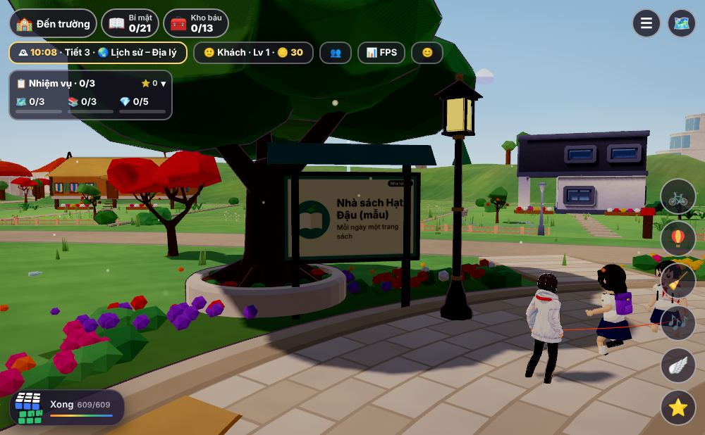 Biển gỗ Quảng trường | 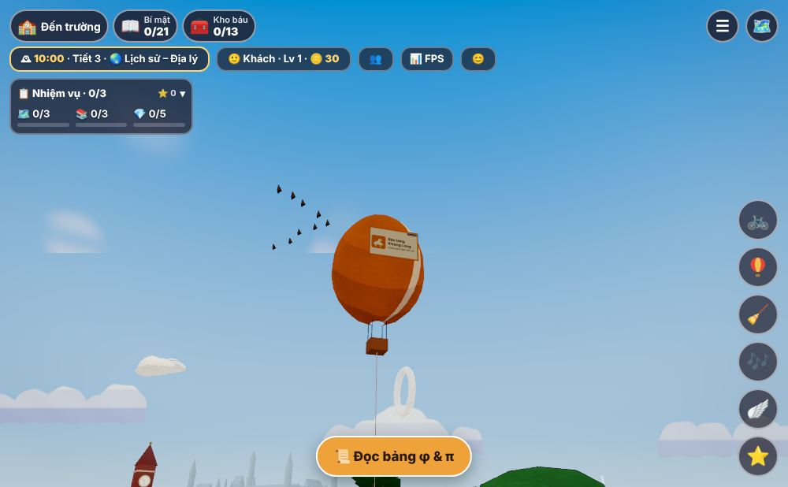 Khinh khí cầu neo |
| 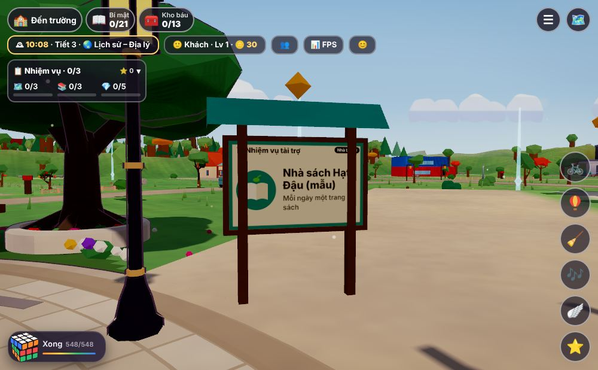 Bảng Nhiệm vụ tài trợ | 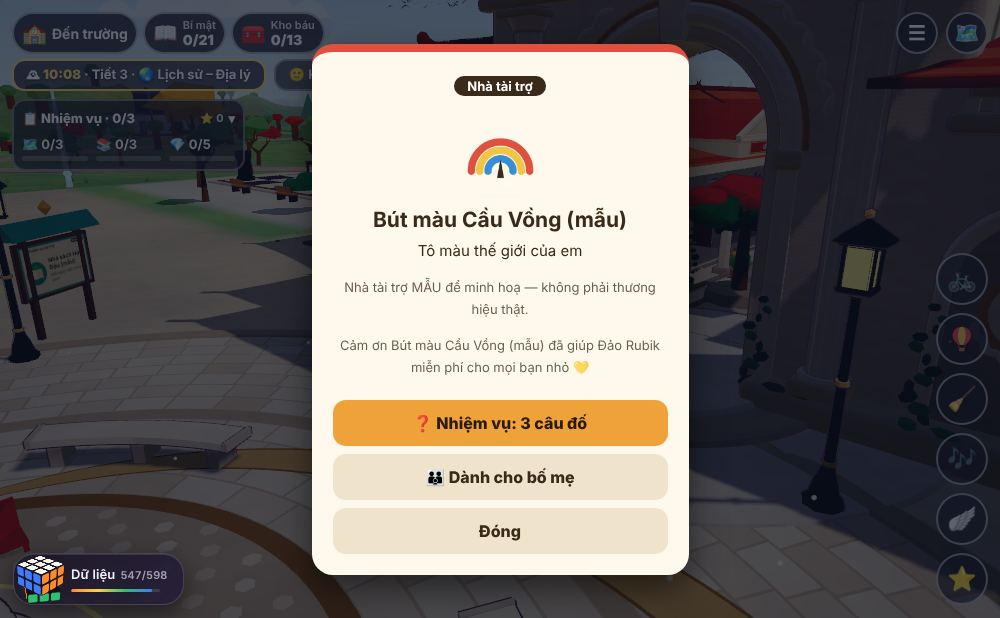 Thẻ thông tin (bé tự mở) |
| 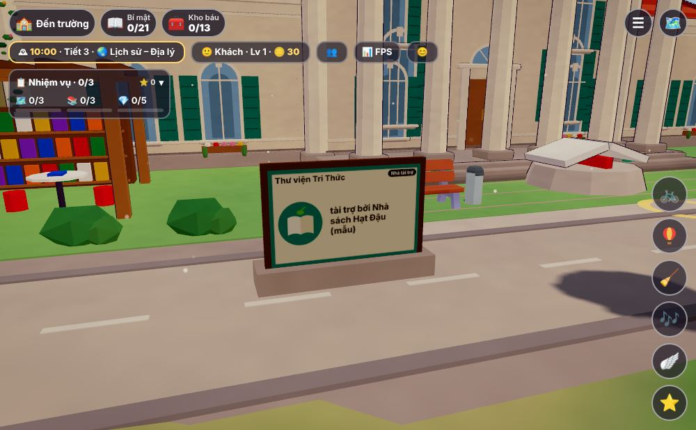 Bảng tên Thư viện | 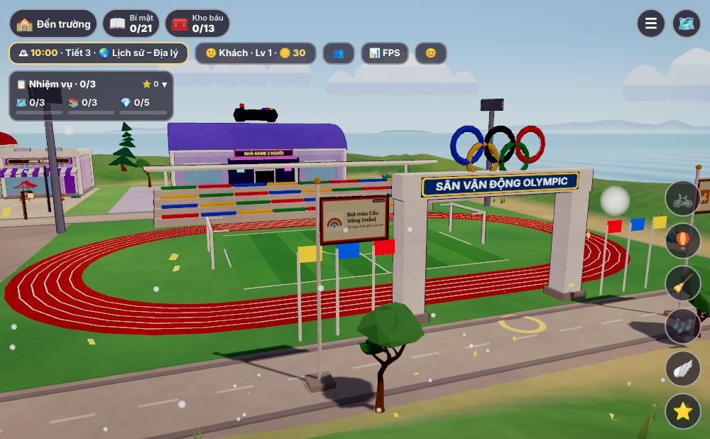 Cờ Sân vận động |
| 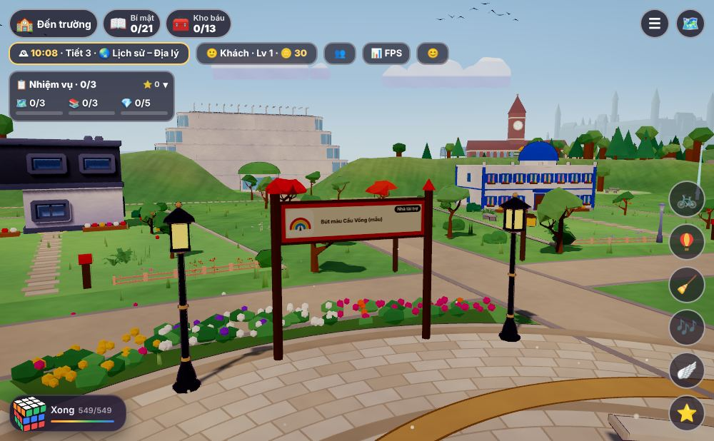 Cổng xuất phát bay chổi | 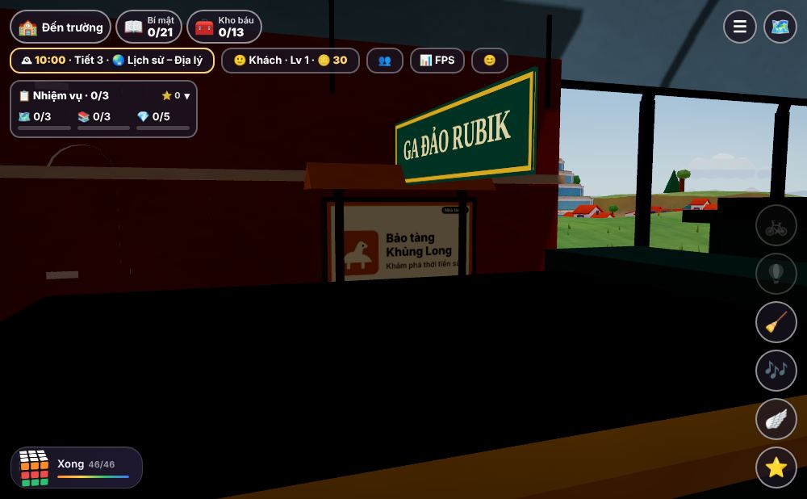 Bảng sân ga |
| 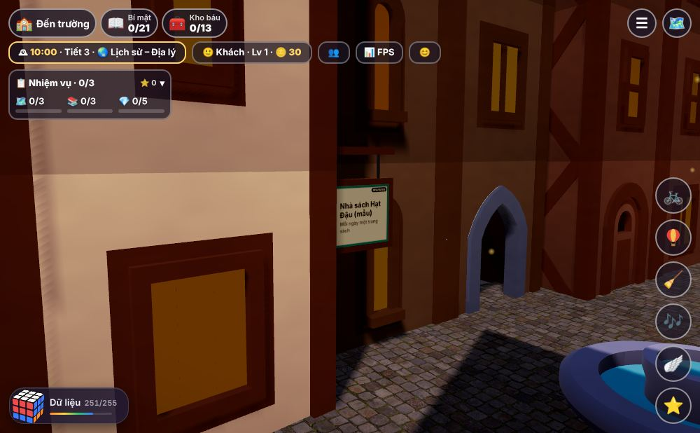 Phố Phép Thuật | 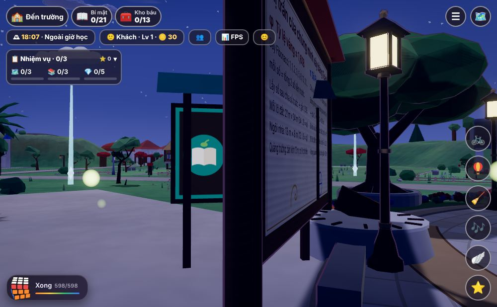 Biến thể ban đêm (biển được đèn soi) |
| 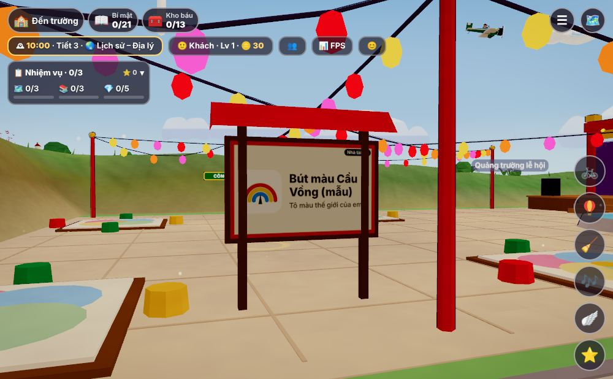 Quảng trường phố | 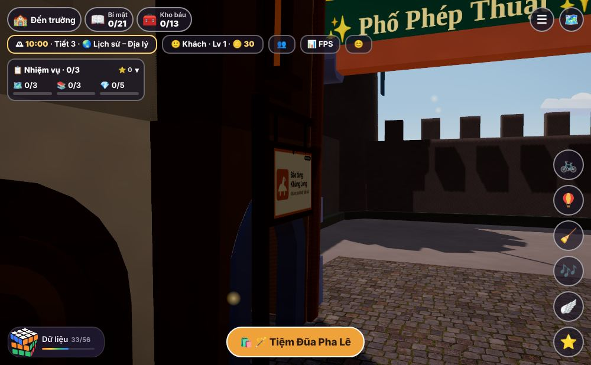 Cổng Phố Phép Thuật |

Toàn bộ biển dùng chung 1 tấm ảnh (atlas) — xem `shots/sponsors/atlas.jpg`.

## 5. Nhà tài trợ cần gửi
1. **Logo** PNG/WebP nền trong suốt, vuông, ≥ 512 px (hệ thống tự thu về 512 px). Tuỳ chọn: logo bản tối cho ban đêm.
2. **Tên hiển thị** ≤ 34 ký tự · **thông điệp** ≤ 55 ký tự (tích cực, không kêu gọi mua hàng trực tiếp với trẻ) · **màu thương hiệu**.
3. **Giới thiệu** 1 câu ≤ 144 ký tự (hiện trong thẻ thông tin).
4. **Link** https (chỉ phụ huynh thấy, sau cổng phụ huynh).
5. (Tuỳ chọn) **3 câu đố kiến thức** về chủ đề của bạn — 2–4 đáp án, đáp án đúng, giải thích khi sai. Ví dụ nhà sách: *“Phần liệt kê các chương và số trang gọi là gì?”*

## 6. Báo cáo cho nhà tài trợ
Xuất trong `/admin/sponsors` → **📊 Báo cáo** (chọn nhà tài trợ, khoảng ngày) → **CSV** (Excel) hoặc **PDF** (in → Lưu thành PDF):

| Chỉ số | Định nghĩa |
|---|---|
| Lượt hiển thị | Biển nằm trong khung nhìn của người chơi **≥ 1 giây** (tối đa 1 lần/phút/người chơi/vị trí) |
| Lượt ghé | Người chơi lại gần biển ≤ 8 m (tối đa 1 lần/5 phút) |
| Mở thẻ | Bé tự bấm E để xem thẻ thông tin |
| Bắt đầu / Hoàn thành nhiệm vụ | Bé làm 3 câu đố; hoàn thành = đúng ≥ 2 câu, tính lần đầu |

Số liệu theo **ngày × vị trí**, gộp và ẩn danh.

## 7. Quy trình cho chủ dự án
1. Ký thoả thuận, nhận tư liệu (mục 5).
2. `/admin/sponsors` (mã `ADMIN_KEY`) → **Thêm nhà tài trợ** → tải logo → **Duyệt** (hệ thống báo lỗi nếu ngành hàng/từ ngữ không phù hợp).
3. **Gán vị trí & lịch chạy** (từ ngày – đến ngày). Biển lên đảo ngay hôm bắt đầu, tự gỡ khi hết hạn (vị trí trống hiện lời nhắn của đảo).
4. Cuối kỳ: xuất báo cáo CSV/PDF gửi nhà tài trợ.
5. Bản tĩnh không server (link artifact): **Xuất JSON tĩnh** → thay file `client/sponsors/config.json`.
